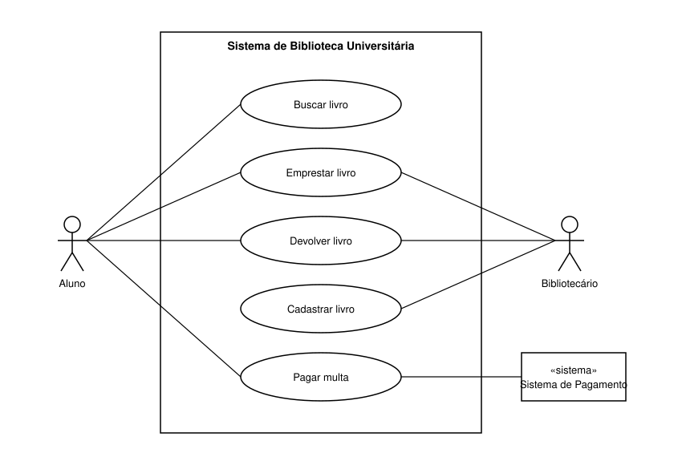

# Especificação de Caso de Uso — Emprestar livro

**Sistema:** Sistema de Biblioteca Universitária

## Diagrama

**Atores**
- **Aluno** (principal)
- **Bibliotecário** (principal)
- **Sistema de Pagamento** (secundário, sistema externo, atua em *Pagar multa*)

**Casos de uso:** Buscar livro, Emprestar livro, Devolver livro, Cadastrar livro, Pagar multa.

---

## UC02 — Emprestar livro

| Item | Descrição |
|---|---|
| **Atores** | Aluno (principal), Bibliotecário (principal) |
| **Descrição** | Permite registrar o empréstimo de um exemplar do acervo para um aluno cadastrado. |
| **Gatilho** | O aluno chega ao balcão e apresenta o livro desejado e sua carteirinha ao bibliotecário. |

### Pré-condições
1. O bibliotecário está autenticado no sistema.
2. O aluno possui cadastro ativo na biblioteca.
3. O exemplar existe no acervo e está com status "disponível".

### Pós-condições
1. O empréstimo fica registrado no histórico do aluno.
2. O exemplar passa ao status "emprestado".
3. A data de devolução prevista fica definida (7 dias corridos).

### Fluxo principal
1. O aluno entrega a carteirinha e o livro ao bibliotecário.
2. O bibliotecário informa no sistema a matrícula do aluno.
3. O sistema valida o cadastro do aluno e verifica se não há multas pendentes.
4. O bibliotecário informa o código do exemplar.
5. O sistema verifica que o exemplar está disponível e não possui reserva de outro aluno.
6. O sistema calcula a data de devolução prevista.
7. O sistema exibe o resumo do empréstimo (aluno, livro e data de devolução).
8. O bibliotecário confirma o empréstimo.
9. O sistema registra o empréstimo e atualiza o status do exemplar para "emprestado".
10. O sistema emite o comprovante e o bibliotecário o entrega ao aluno junto com o livro.
11. O caso de uso é encerrado.

### Fluxo alternativo A1 — Exemplar reservado por outro aluno
- **Quando:** no passo 5, o exemplar está reservado para outro aluno.
- **Passos:**
  1. O sistema informa que o exemplar está reservado e exibe a posição do aluno na fila.
  2. O bibliotecário comunica o fato ao aluno.
  3. O aluno escolhe outro exemplar ou outro livro, ou opta por entrar na fila de reserva.
  4. Se escolher outro exemplar, o bibliotecário informa o novo código.
- **Retorno:** volta ao passo 5 do fluxo principal com o novo exemplar. Se o aluno desistir, o caso de uso termina sem empréstimo.

### Fluxo de exceção E1 — Aluno com multa pendente
- **Quando:** no passo 3, o sistema identifica multa pendente em nome do aluno.
- **Passos:**
  1. O sistema bloqueia o empréstimo e exibe o valor da multa pendente.
  2. O bibliotecário informa o aluno sobre o bloqueio.
  3. O sistema oferece o acesso ao caso de uso **Pagar multa** (processado pelo Sistema de Pagamento).
- **Retorno:** se a multa for quitada, volta ao passo 3 do fluxo principal. Caso contrário, o caso de uso é encerrado sem registrar empréstimo.
